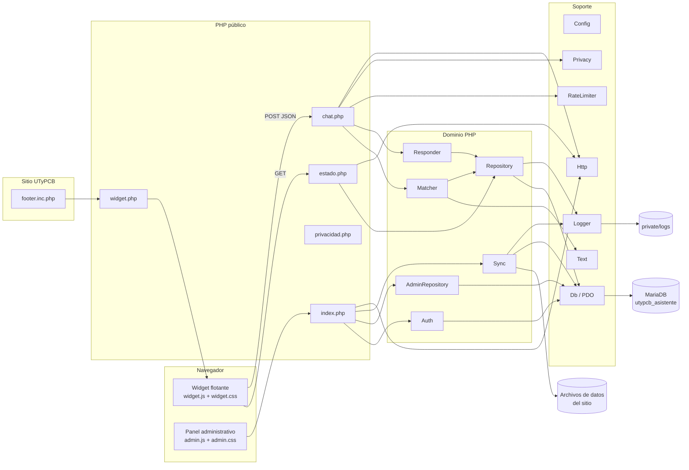
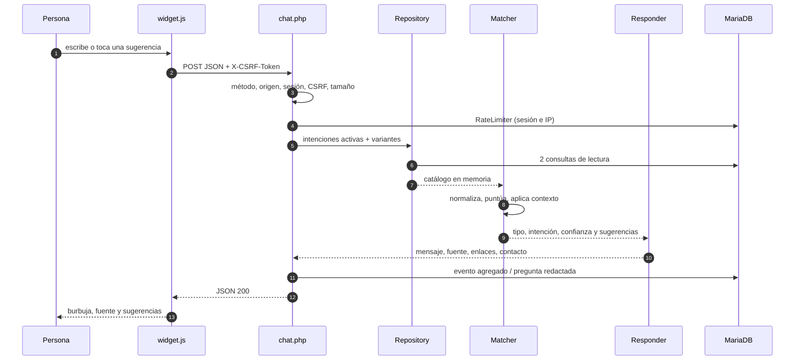
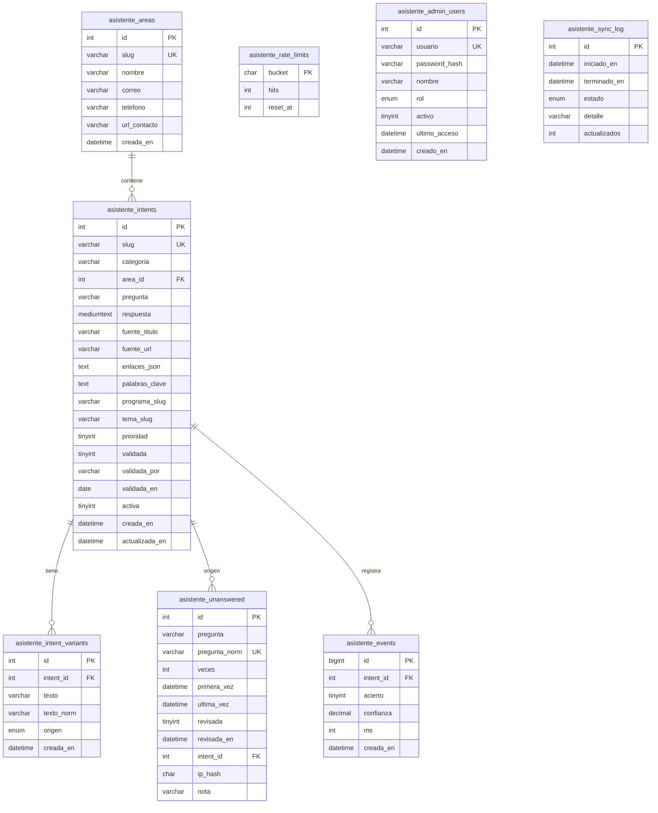
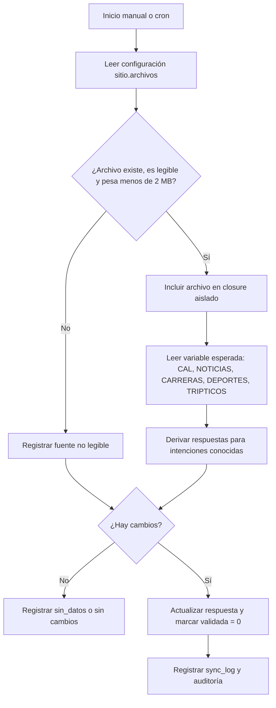

# 02 · Manual técnico

**Proyecto:** Asistente Coyote · UTyPCB
**Versión:** 1.0.0
**Fecha:** 6 de noviembre de 2026
**Audiencia:** responsable técnico, desarrollador de mantenimiento y administrador de infraestructura.

## 1. Resumen

El Asistente Coyote es una aplicación PHP con base de datos MariaDB que responde
preguntas sobre la Universidad Tecnológica y Politécnica de Coyuca de Benítez. No
usa modelos de lenguaje, servicios externos ni procesos de scraping: el motor es
determinista y trabaja con una base de conocimiento editorial revisable.

La aplicación tiene tres superficies:

1. **API pública** en `public/asistente/estado.php` y `public/asistente/chat.php`.
2. **Widget flotante** en `public/asistente/widget.php`, cargado desde el pie del sitio.
3. **Panel administrativo** en `public/asistente/admin/index.php`.

El contenido se alimenta de dos fuentes:

- La **semilla** versionada (`database/seed/*.php`): 156 intenciones y 780 variantes.
- La **sincronización** con los archivos de datos publicados por el sitio
  (`calendario_data.php`, `noticias_data.php`, `carreras_data.php`,
  `deportes_data.php`, `tripticos_data.php`).

## 2. Stack tecnológico

| Componente | Versión objetivo | Verificación realizada |
| --- | --- | --- |
| PHP | 7.4 y 8.x | Ejecución completa en PHP 8.5.12; revisión estática de sintaxis compatible con 7.4 |
| MariaDB | 10.11 | Esquema y consultas probados en MariaDB 13.0.2 (compatible con 10.11) |
| Extensiones PHP | `pdo_mysql`, `mbstring`, `json` | Presentes en el entorno de pruebas |
| Servidor web | Apache o Nginx con PHP-FPM | Pruebas HTTP con el servidor integrado de PHP |
| Frontend | HTML, CSS y JavaScript nativos | Sin jQuery, Bootstrap, Tailwind ni frameworks |
| Dependencias | Ninguna | No hay Composer, npm ni CDN en el widget |

El código declara `strict_types=1`, usa clases `final`, tipos escalares, tipos de
retorno y un autoloader propio basado en el prefijo `Utypcb\Asistente\`. No usa
construcciones exclusivas de PHP 8 (por ejemplo `match`, `readonly`, enums,
`str_contains` ni propiedad promovida con promoción de constructor), por lo que
puede ejecutarse en PHP 7.4.

## 3. Arquitectura

### 3.1 Vista de componentes



### 3.2 Estructura de directorios

```text
asistente-utypcb/
├── public/                      # única carpeta publicada
│   ├── asistente/
│   │   ├── admin/               # panel (interfaz)
│   │   │   ├── index.php
│   │   │   ├── admin.css
│   │   │   └── admin.js
│   │   ├── chat.php             # API POST
│   │   ├── estado.php           # API GET
│   │   ├── demo.php / demo.js   # demostración aislada
│   │   ├── pagina.css
│   │   ├── privacidad.php       # aviso de privacidad
│   │   ├── widget.php           # marcado del widget
│   │   ├── widget.css
│   │   └── widget.js
│   └── (resto del sitio existente)
├── private/                     # fuera de public_html en producción
│   ├── bin/                     # comandos CLI
│   ├── config.php               # NO se distribuye (credenciales locales)
│   ├── config.example.php       # plantilla segura
│   ├── logs/
│   ├── src/
│   │   ├── Admin/
│   │   ├── Api/
│   │   ├── Knowledge/
│   │   ├── Site/
│   │   ├── Support/
│   │   └── bootstrap.php
│   └── views/
├── database/
│   ├── schema.sql
│   └── seed/                    # 13 archivos de contenido
├── tests/
│   ├── preguntas_100.php
│   └── resultados/
├── integracion/
│   ├── footer.inc.php.example
│   └── LEEME.md
├── documentacion/
└── README.md
```

### 3.3 Capas y responsabilidades

| Capa | Archivos | Responsabilidad |
| --- | --- | --- |
| Entrada HTTP | `estado.php`, `chat.php`, `admin/index.php` | Cargar el arranque, delegar y devolver la respuesta |
| API | `Api/ChatApi.php`, `Api/Endpoint.php` | Validar método, origen, sesión, CSRF, cuerpo y límites |
| Dominio | `Knowledge/Matcher.php`, `Responder.php` | Interpretar la pregunta y construir la respuesta |
| Persistencia | `Knowledge/Repository.php`, `Admin/AdminRepository.php`, `Support/Db.php` | Consultas preparadas y mapeo de filas |
| Administración | `Admin/AdminApp.php`, `Auth.php` | Rutas, autenticación, CRUD, auditoría |
| Sincronización | `Site/Sync.php` | Leer archivos del sitio y actualizar respuestas |
| Soporte | `Config`, `Http`, `RateLimiter`, `Privacy`, `Logger`, `Text`, `View` | Configuración, protocolo, límites, privacidad, bitácoras, texto y vistas |

## 4. Ciclo de una pregunta

### 4.1 Secuencia



### 4.2 Etapas

1. **Arranque.** `bootstrap.php` registra el autoloader, carga la configuración
   (por defecto `private/config.php`) y fija la zona horaria.
2. **Sesión.** `Http::sesionChat()` inicia la cookie `UTYPCHAT` con `HttpOnly`,
   `SameSite=Lax` y `Secure` cuando la petición es HTTPS.
3. **Validaciones de protocolo.** Solo `POST`, mismo origen, token CSRF de 64
   caracteres hexadecimales y cuerpo JSON de máximo 4096 bytes.
4. **Mensaje.** Se eliminan caracteres de control, se recorta y se exige entre 2 y
   300 caracteres (configurable).
5. **Límite de uso.** `RateLimiter` consume un cupo por sesión (20 cada 5 minutos)
   y otro por IP (120 cada 10 minutos). Si falla, responde `429` con `Retry-After`.
6. **Catálogo.** `Repository::intenciones()` lee solo intenciones `activa = 1`,
   con sus áreas y variantes. Son dos consultas; el índice se construye en memoria
   una vez por solicitud.
7. **Motor.** `Matcher::resolver()` normaliza, detecta programa y tema, recupera
   el contexto vigente y puntúa cada variante. Devuelve un tipo:
   `intencion`, `ambigua`, `sin_respuesta`, `saludo`, `gracias`, `despedida`,
   `identidad`, `capacidades` o `aclaracion`.
8. **Respuesta.** `Responder::construir()` agrega mensaje, fuente oficial, enlaces
   seguros, contacto del área y sugerencias.
9. **Registro.** Se guarda un evento agregado (intención, acierto, confianza y
   milisegundos). Si no hubo respuesta, se guarda la pregunta redactada en la
   bandeja de revisión.
10. **Salida.** JSON con `Cache-Control: no-store`, `X-Content-Type-Options` y
    `Referrer-Policy: no-referrer`.

## 5. Motor de conocimiento

### 5.1 Normalización y tokens

`Support/Text.php` aplica este proceso:

1. Recorta espacios y convierte signos tipográficos (`“ ” ‘ ’ – —`) en espacios.
2. Sustituye vocales acentuadas, `ñ` y `ç` por su equivalente sin acento.
3. Convierte a minúsculas y corrige separadores como `pre-registro` y `pre inscripción`.
4. Retira separadores de miles (`1,500` → `1500`).
5. Reemplaza todo carácter que no sea letra o dígito por espacio y colapsa espacios.

Después, `tokens()` divide por espacios y:

- conserva números;
- elimina palabras vacías (`de`, `la`, `que`, `para`, etc.) y palabras de una letra;
- aplica un diccionario de sinónimos (`costo` → `costo`, `colegiatura` → `costo`,
  `carrera` → `oferta`, `tsu` → `tsu`, entre otros);
- reduce plurales y terminaciones ligeras (`-ces` → `-z`, `-es`, `-s`).

El resultado es un conjunto sin duplicados que alimenta el índice y la consulta.

### 5.2 Índice e IDF

Para cada variante se guardan:

- texto y texto normalizado;
- conjunto y lista de tokens;
- trigramas de caracteres (con dos espacios de relleno);
- suma de pesos IDF de sus tokens.

El peso de un token se calcula una vez por solicitud:

```text
idf(token) = min(6, ln((N + 1) / (df(token) + 1)) + 1)
```

donde `N` es el total de variantes y `df` el número de variantes que contienen el
token. Un token desconocido recibe el peso máximo (6), lo que aumenta su impacto
en la consulta y activa la regla de ancla.

### 5.3 Puntuación de una variante

Para cada token de la pregunta:

- si coincide exactamente, suma su peso IDF;
- si no, busca la mejor coincidencia difusa entre los tokens de la variante
  (Levenshtein con tolerancia de 1 o 2 ediciones y misma letra inicial) y suma
  `peso × similitud`.

Con la masa coincidente se calculan:

```text
recall    = coincidencia / suma_idf_pregunta
precision = coincidencia / suma_idf_variante
f1        = 2 × recall × precision / (recall + precision)
cobertura = 0.65 × recall + 0.35 × f1
trigramas = 2 × trigramas_comunes / (trigramas_pregunta + trigramas_variante)
```

y el puntaje base de la variante:

```text
score = min(1, 0.70 × cobertura + 0.20 × trigramas + bonus_frase)
```

`bonus_frase` vale:

| Situación | Bonificación |
| --- | ---: |
| La pregunta normalizada es idéntica a la variante | +0.15 |
| La variante contiene la pregunta (pregunta de 6+ caracteres) | +0.06 |
| La pregunta contiene la variante (variante de 6+ caracteres) | +0.08 |

La mejor variante de cada intención representa a esa intención.

### 5.4 Ajustes por intención

Sobre el puntaje de la mejor variante se aplica:

| Ajuste | Valor |
| --- | ---: |
| Palabras clave presentes (frase +0.04; token +0.03, máximo total) | hasta +0.10 |
| La intención pertenece al programa detectado | +0.08 |
| La intención pertenece a otro programa | −0.25 |
| El tema detectado coincide con el tema de la intención | +0.04 |
| Es seguimiento y el tema coincide con el contexto | +0.04 |
| Prioridad editorial (máximo) | +0.02 |

El resultado se limita al rango 0–1.

**Regla de ancla.** Si la pregunta contiene al menos un token que no existe en el
catálogo, se exige que también contenga un término institucional que no sea
genérico (`cuanto`, `costo`, `pago`). Así se evita que «cuánto cuesta una pizza»
se responda con el costo de la colegiatura: se descarta la variante y se ofrece
el resguardo.

**Ancla de programa.** Los alias de los cinco programas (Ingeniería Civil,
Comercio Internacional y Aduanas, Energía y Desarrollo Sostenible, Tecnologías de
la Información e Innovación Digital, Manejo de Recursos Naturales) se detectan
por frase completa y se conservan en el contexto.

### 5.5 Umbral, ambigüedad y sugerencias

| Parámetro | Valor | Efecto |
| --- | ---: | --- |
| `umbral` | 0.40 | Por debajo se responde con resguardo |
| `margen` | 0.02 | Diferencia mínima con la segunda opción |
| `max_sugerencias` | 4 | Sugerencias devueltas |
| `max_contexto` | 6 | Entradas de historial conservadas |
| `contexto_ttl_minutos` | 30 | Vigencia del contexto |

Se responde `ambigua` cuando existe una segunda intención y se cumple alguna de
estas condiciones:

- la mejor confianza es menor a 0.92 y la diferencia es menor al margen;
- hay un empate exacto entre dos intenciones cuya variante coincide literalmente
  con la pregunta.

En ese caso no se afirma una respuesta: se muestran las opciones para que la
persona elija. Las sugerencias se toman de los resultados con puntaje mínimo
0.28–0.32, sin repetir intención.

### 5.6 Contexto conversacional

El contexto vive solo en la sesión PHP:

```json
{
  "programa": "iti-innovacion-digital",
  "tema": "costos",
  "intent": 42,
  "historial": [
    {"intent": 42, "programa": "iti-innovacion-digital", "tema": "costos", "ts": 1760000000}
  ],
  "actualizado": 1760000000
}
```

Reglas:

- Si cambia el programa detectado, se limpia el tema anterior.
- Un seguimiento se reconoce por iniciar con `y`, `e`, `entonces`, `ademas`,
  `tambien`, `ahora`, `bueno`, `ok`, `otra`, `otro`, o por tener dos tokens o menos.
- Si el seguimiento no trae programa, se hereda el del contexto; el tema también
  se hereda y suma +0.04 a las intenciones de ese tema.
- El historial se recorta a las últimas 6 entradas y todo el contexto caduca a
  los 30 minutos de inactividad.
- La acción `reiniciar` borra contexto y marca de tiempo.

### 5.7 Casos especiales

| Caso | Comportamiento |
| --- | --- |
| Saludo, gracias, despedida, identidad o capacidades | Respuesta conversacional sin consultar el catálogo |
| Mensaje sin tokens útiles | Pide reformular la pregunta |
| Pregunta por marcadores o resultados deportivos | Resguardo: el catálogo no publica resultados y no se inventan |
| Pregunta sin coincidencia suficiente | Resguardo con el área responsable del tema detectado |
| Tema desconocido | Canaliza a Servicios Escolares |
| Programa detectado sin coincidencia | Resguardo y conserva el programa para el siguiente turno |

### 5.8 Ejemplo

Pregunta: «¿Cuánto cuesta la ficha de admisión?»

1. Normalización: `cuanto cuesta la ficha de admision`.
2. Tokens: `cuanto`, `cuesta`, `ficha`, `admision` (se eliminan `la` y `de`).
3. Se detecta el tema `admision` por `ficha` y `admision`.
4. Las variantes de la intención `admision-costo-ficha` contienen `ficha` y
   `admision`; la cobertura y los trigramas producen un puntaje superior al umbral.
5. El ajuste por tema suma +0.04 y la intención gana.
6. `Responder` devuelve la respuesta oficial, la fuente y el enlace de admisión.

### 5.9 Configuración del motor

Los parámetros viven en `private/config.php`, sección `motor`:

```php
'motor' => [
    'min_mensaje' => 2,
    'max_mensaje' => 300,
    'umbral' => 0.40,
    'margen' => 0.02,
    'max_sugerencias' => 4,
    'max_contexto' => 6,
    'contexto_ttl_minutos' => 30,
],
```

Cambiar `umbral` a un valor más bajo aumenta la cobertura pero también el riesgo
de respuestas incorrectas; subirlo aumenta la precisión y deriva más preguntas al
resguardo. Los valores entregados fueron los usados en la evaluación de 100
preguntas.

## 6. Modelo de datos

### 6.1 Diagrama entidad-relación



La tabla `asistente_sync_log` no tiene clave foránea hacia las intenciones; registra
cada ejecución de sincronización de forma independiente.

### 6.2 Tablas

| Tabla | Propósito | Notas |
| --- | --- | --- |
| `asistente_areas` | Áreas responsables y datos de contacto | Una por tema de canalización |
| `asistente_intents` | Pregunta principal, respuesta, fuente y metadatos | `slug` único; `activa` controla la publicación |
| `asistente_intent_variants` | Formas de escribir cada pregunta | `texto_norm` único por intención; `origen` base/admin |
| `asistente_unanswered` | Preguntas sin respuesta redactadas | Única por `pregunta_norm`; acumula `veces` |
| `asistente_events` | Métricas agregadas | Sin texto de conversación ni IP |
| `asistente_rate_limits` | Ventanas de límite de uso | Bucket SHA-256; se purga al vencer |
| `asistente_admin_users` | Cuentas del panel | Contraseña con `password_hash`; `rol` (`superadmin`/`admin`) |
| `asistente_sync_log` | Historial de sincronizaciones | Estado, detalle y actualizados |

Todas las tablas usan InnoDB y `utf8mb4_unicode_ci`, salvo `rate_limits` que usa
`ascii_bin` por contener solo hashes. Las claves foráneas usan `RESTRICT` en áreas,
`CASCADE` en variantes y `SET NULL` en eventos y preguntas convertidas.

### 6.3 Índices y retención

- `idx_intents_activa (activa, categoria)` para el listado público.
- `idx_intents_programa (programa_slug, tema_slug)` para filtros editoriales.
- `idx_variants_norm (texto_norm)` para detección de duplicados.
- `idx_unanswered_revisada (revisada, ultima_vez)` para la bandeja.
- `idx_events_fecha (creada_en)` para métricas y purga.
- `idx_rate_reset (reset_at)` para limpieza de ventanas.
- `idx_sync_fecha (iniciado_en)` para el historial.

La retención se aplica con `private/bin/purgar.php`:

| Dato | Retención |
| --- | --- |
| Preguntas sin respuesta | 90 días desde `ultima_vez` |
| Eventos agregados | 365 días desde `creada_en` |
| Límites de uso vencidos | Se eliminan al reiniciarse o en la purga |
| Conversaciones completas | No se almacenan |

## 7. API HTTP

### 7.1 Endpoints

| Método | Ruta | Función |
| --- | --- | --- |
| `GET` | `/asistente/estado.php` | Estado, CSRF, límites, aviso y sugerencias iniciales |
| `POST` | `/asistente/chat.php` | Resolver una pregunta o reiniciar el contexto |
| `GET` | `/asistente/privacidad.php` | Aviso de privacidad |
| `GET` | `/asistente/admin/` | Panel administrativo (redirige al acceso) |

No existe endpoint de escritura pública, ni CORS abierto, ni acceso directo a la
base de datos desde el navegador.

### 7.2 `GET /asistente/estado.php`

Respuesta `200`:

```json
{
  "ok": true,
  "csrf": "64 caracteres hexadecimales",
  "limites": {
    "min_mensaje": 2,
    "max_mensaje": 300
  },
  "privacidad": {
    "url": "/asistente/privacidad.php",
    "responsable": "Departamento de Servicios Escolares de la UTyPCB"
  },
  "sugerencias": [
    {"slug": "admision-ficha", "pregunta": "¿Cuánto cuesta la ficha de admisión?", "categoria": "admision"}
  ]
}
```

La sesión se crea en esta llamada; el token CSRF se reutiliza en la sesión y se
envía en la cabecera `X-CSRF-Token` del siguiente `POST`.

### 7.3 `POST /asistente/chat.php`

Solicitud:

```http
POST /asistente/chat.php HTTP/1.1
Content-Type: application/json
X-CSRF-Token: <token>
Cookie: UTYPCHAT=<sesión>

{"accion":"mensaje","mensaje":"¿Cuándo es el examen de admisión?"}
```

Para reiniciar:

```json
{"accion":"reiniciar"}
```

Respuesta de una intención:

```json
{
  "ok": true,
  "tipo": "respuesta",
  "mensaje": "Texto oficial de la respuesta...",
  "fuente": {
    "titulo": "Admisión · UTyPCB",
    "url": "https://utypcb.edu.mx/..."
  },
  "enlaces": [
    {"titulo": "Convocatoria de admisión", "url": "https://utypcb.edu.mx/..."}
  ],
  "contacto": null,
  "sugerencias": [
    {"slug": "admision-requisitos", "pregunta": "¿Cuáles son los requisitos de admisión?"}
  ],
  "confianza": 0.842,
  "intent": "admision-fecha-examen",
  "categoria": "Admisión y nuevo ingreso",
  "contexto": {
    "programa": null,
    "tema": "admision"
  }
}
```

Respuesta de resguardo:

```json
{
  "ok": true,
  "tipo": "sin_respuesta",
  "mensaje": "No tengo una respuesta verificada para esa pregunta...",
  "fuente": {"titulo": "Sitio oficial de la UTyPCB", "url": "https://utypcb.edu.mx/home.php"},
  "enlaces": [],
  "contacto": {
    "area": "Servicios Escolares",
    "correo": "correo@utypcb.edu.mx",
    "telefono": "...",
    "url": "https://utypcb.edu.mx/..."
  },
  "sugerencias": [],
  "confianza": 0,
  "intent": null,
  "categoria": null,
  "contexto": {"programa": null, "tema": "admision"}
}
```

Respuesta de ambigüedad: `tipo: "ambigua"`, con la pregunta de aclaración y las
sugerencias candidatas.

### 7.4 Códigos de error

| Código | Causa | Cuerpo |
| ---: | --- | --- |
| 400 | JSON vacío o inválido | `{"ok":false,"error":"..."}` |
| 403 | CSRF inválido, sesión inactiva u origen no permitido | Mensaje genérico |
| 405 | Método incorrecto | Cabecera `Allow` |
| 413 | Cuerpo mayor a 4096 bytes | Mensaje de tamaño |
| 415 | `Content-Type` distinto de JSON | Formato no soportado |
| 422 | Mensaje ausente, corto, largo o acción inválida | Mensaje explicativo |
| 429 | Límite por sesión o IP | Cabecera `Retry-After` |
| 500 | Error interno | Mensaje genérico; detalle solo en bitácora |
| 503 | Configuración ausente o inválida | `{"ok":false,"error":"Servicio no disponible."}` |

### 7.5 Cabeceras

- `Content-Type: application/json; charset=utf-8`
- `Cache-Control: no-store, no-cache, must-revalidate, max-age=0`
- `Pragma: no-cache`
- `X-Content-Type-Options: nosniff`
- `Referrer-Policy: no-referrer`
- Sin `Access-Control-Allow-Origin`.

## 8. Seguridad

### 8.1 Controles por amenaza

| Amenaza | Control |
| --- | --- |
| Inyección SQL | PDO con consultas preparadas nativas; sin concatenar datos del usuario |
| XSS | Escape en vistas con `View::e`; `textContent` en JavaScript; validación de URLs |
| CSRF | Token de 32 bytes por sesión, comparación con `hash_equals` |
| Peticiones cruzadas | Verificación de `Origin`/`Referer` contra el host actual y el sitio configurado; sin CORS |
| Fijación de sesión | `session.use_strict_mode`, regeneración al iniciar sesión y al cambiar contraseña |
| Robo de cookie | `HttpOnly`, `SameSite=Lax`, `Secure` en HTTPS, ruta restringida para admin |
| Fuerza bruta | Límite de acceso por IP y usuario; contraseña con `password_hash` |
| Escalada de privilegios | Rol verificado en el servidor; las cuentas de apoyo reciben 403 en rutas de gestión |
| Abuso de la API | Límite por sesión y por IP con respuesta `429` |
| Cuerpos maliciosos | Límite de 4096 bytes, tipo JSON, eliminación de caracteres de control |
| Fugas en bitácoras | Claves sensibles omitidas; sin texto de conversación ni IP completa |
| Fuga de configuración | Configuración y credenciales fuera de `public/`; plantilla sin secretos |
| Clickjacking | `X-Frame-Options: SAMEORIGIN` y `frame-ancestors 'self'` |
| MIME sniffing | `X-Content-Type-Options: nosniff` |
| Referer | `Referrer-Policy: no-referrer` |
| Permisos del navegador | `Permissions-Policy` desactiva cámara, micrófono y geolocalización |

### 8.2 Sesiones

| Aspecto | Chat | Administración |
| --- | --- | --- |
| Nombre de cookie | `UTYPCHAT` | `UTYPADM` |
| Ruta | `/` | `/asistente/admin` |
| Duración | Sesión del navegador | Sesión del navegador |
| Inactividad | Sin límite explícito | 30 minutos |
| Uso | Contexto y CSRF | Autenticación y CSRF |

Las dos sesiones son independientes: cerrar la sesión administrativa no borra el
contexto del chat, y el chat no puede acceder a funciones administrativas.

### 8.3 Autenticación administrativa

- Las cuentas se crean por consola con `private/bin/crear-admin.php` o desde el
  panel por una cuenta principal.
- La contraseña se guarda con `password_hash(..., PASSWORD_DEFAULT)` y se verifica
  con `password_verify`.
- Los intentos de acceso se limitan a 5 por ventana de 15 minutos por IP y usuario.
- El panel no tiene autorregistro ni recuperación por correo.
- Todas las acciones POST exigen CSRF.
- Cada acción relevante se registra en `private/logs/auditoria.log` con el usuario.

#### Roles

| Rol | Alcance |
| --- | --- |
| `superadmin` | Todo el panel y la gestión de cuentas (`?r=admins`) |
| `admin` | Revisión y edición del contenido; sin gestión de cuentas |

`AdminApp::exigirSuperadmin()` valida el rol en el servidor antes de mostrar o
procesar cualquier acción de gestión. Ocultar el enlace en el menú es solo una
ayuda visual; la autorización real está en el controlador y responde `403`.

Salvaguardas de las cuentas:

- el nombre de usuario debe cumplir `^[a-z0-9._-]{3,60}$` y ser único;
- las cuentas creadas desde el panel siempre son `admin`;
- una cuenta no puede desactivarse a sí misma;
- no se puede desactivar la última cuenta `superadmin` activa;
- el cambio de contraseña exige la contraseña actual y una nueva distinta;
- el restablecimiento desde **Administradores** no muestra la contraseña anterior.

La instalación incluye la cuenta `oliver` con rol `superadmin`; su credencial
inicial se documenta en el manual del administrador y debe cambiarse en el primer
acceso. La contraseña se almacena cifrada y no puede recuperarse.

### 8.4 Validación de salida y enlaces

`Catalog::urlSegura()` solo acepta URLs absolutas `http` o `https`, sin usuario,
contraseña, espacios, comillas ni más de 500 caracteres. `Catalog::correoSeguro()`
valida el correo con `FILTER_VALIDATE_EMAIL`. Las respuestas y los enlaces se
escapan en la interfaz; el widget crea nodos con `textContent` y asigna `href`
solo después de la validación del servidor.

### 8.5 Privacidad

- Las preguntas sin respuesta se guardan **redactadas**: se eliminan correos,
  CURP, teléfonos y secuencias de dígitos largas.
- La IP se guarda solo como HMAC-SHA-256 con una sal secreta; nunca en claro.
- Los eventos guardan intención, acierto, confianza y milisegundos, sin el texto
  de la conversación.
- La retención es de 90 días para preguntas y 365 para eventos.
- El aviso público está en `public/asistente/privacidad.php`.

### 8.6 Contraseñas y secretos

`private/config.php` no se distribuye. La plantilla `config.example.php` contiene
marcadores como `CAMBIA_ESTA_CONTRASENA` y una sal de ejemplo que debe sustituirse
por una cadena aleatoria de al menos 48 caracteres. La contraseña local de MariaDB
usada durante el desarrollo no forma parte de la entrega ni de la documentación.
La credencial inicial de la cuenta principal `oliver` se documenta únicamente en
la documentación de entrega y debe cambiarse en el primer acceso.

## 9. Sincronización con el sitio

### 9.1 Flujo



### 9.2 Fuentes

| Clave | Archivo | Variable | Uso |
| --- | --- | --- | --- |
| `calendario` | `calendario_data.php` | `$CAL` | Fechas de inicio, exámenes, periodos y vacaciones |
| `noticias` | `noticias_data.php` | `$NOTICIAS` | Noticias y eventos recientes |
| `carreras` | `carreras_data.php` | `$CARRERAS` | Oferta y datos de programas |
| `deportes` | `deportes_data.php` | `$DEPORTES` | Equipos, entrenamientos y torneos |
| `tripticos` | `tripticos_data.php` | `$TRIPTICOS` | Material informativo de programas |

### 9.3 Salvaguardas

- La ruta se resuelve con `realpath` y debe estar dentro del directorio configurado.
- Se rechazan archivos de más de 2 MB.
- El archivo se incluye dentro de una función aislada; solo se acepta la variable
  esperada y debe ser un arreglo.
- Los cambios se aplican por `slug`; no se crean intenciones nuevas desde el sitio.
- Si la respuesta es idéntica, no se actualiza ni se reinicia la validación.
- Cada cambio reinicia `validada` para que el personal lo revise antes de darlo
  por bueno.
- Si no hay fuentes legibles o datos reconocibles, el estado es `sin_datos` y la
  base no se modifica.
- Todo el proceso queda en `asistente_sync_log` y en la bitácora de auditoría.

### 9.4 Idempotencia

La sincronización se probó dos veces seguidas sobre una instalación limpia:

- Primera ejecución: 19 intenciones actualizadas.
- Segunda ejecución: 0 actualizaciones (los textos ya coincidían).
- Fuentes legibles: 5 de 5.

### 9.5 Programación

Opciones admitidas:

- Botón **Sincronizar** del panel (acción `sync-run`).
- Comando `php private/bin/sincronizar.php`.
- Cron del servidor, por ejemplo cada hora:

```cron
0 * * * * /usr/bin/php /ruta/privada/bin/sincronizar.php >> /ruta/privada/logs/cron.log 2>&1
```

La sincronización no requiere que el sitio esté sirviendo HTTP: lee los archivos
del sistema de archivos en la ruta configurada.

## 10. Panel administrativo

### 10.1 Rutas

| Ruta | Tipo | Función |
| --- | --- | --- |
| `?r=login` | GET/POST | Acceso y límite de intentos |
| `?r=dashboard` | GET | Métricas y estado general |
| `?r=intents` | GET | Listado, búsqueda y filtros |
| `?r=intent` | GET | Alta y edición con variantes |
| `?r=intent-save` | POST | Guardar intención y variantes |
| `?r=intent-toggle` | POST | Activar o desactivar |
| `?r=intent-delete` | POST | Eliminar (con confirmación) |
| `?r=intent-validate` | POST | Marcar como validada |
| `?r=intent-unvalidate` | POST | Retirar validación |
| `?r=unanswered` | GET | Bandeja de preguntas sin respuesta |
| `?r=unanswered-update` | POST | Guardar nota, marcar revisión o convertir |
| `?r=unanswered-delete` | POST | Eliminar registro |
| `?r=sync` | GET | Estado de fuentes e historial |
| `?r=sync-run` | POST | Ejecutar sincronización |
| `?r=sync-purge` | POST | Ejecutar purga de retención |
| `?r=cuenta` | GET | Datos de la cuenta |
| `?r=cuenta-save` | POST | Cambiar contraseña |
| `?r=admins` | GET | Gestión de cuentas (solo `superadmin`) |
| `?r=admin-create` | POST | Crear cuenta de apoyo |
| `?r=admin-toggle` | POST | Activar o desactivar cuenta |
| `?r=admin-password` | POST | Restablecer contraseña de una cuenta |
| `?r=logout` | POST | Cerrar sesión |

### 10.2 Reglas de edición

- El `slug` es único y se usa para la sincronización; no se cambia al editar.
- Debe existir al menos una variante; la semilla exige exactamente 5 base.
- Las variantes se normalizan y no pueden repetirse dentro de la intención.
- Al guardar cambios se reinicia la validación.
- Una intención inactiva no se carga en el motor, pero se conserva para auditoría.
- La eliminación se bloquea si hay registros dependientes que lo impidan; se
  prefiere desactivar.

### 10.3 Gestión de cuentas

- Solo `superadmin` accede a `?r=admins` y a las acciones `admin-*`.
- `admin-create` valida usuario, nombre, contraseña y confirmación; crea con rol
  `admin` y `activo = 1`.
- `admin-toggle` impide desactivar la cuenta propia y la última cuenta
  `superadmin` activa.
- `admin-password` exige contraseña nueva de 12 a 200 caracteres y confirmación;
  no solicita la contraseña anterior porque es un restablecimiento.
- El formulario de **Mi cuenta** sí exige la contraseña actual.
- Toda alta, baja, restablecimiento y cambio de contraseña se registra en la
  auditoría con el usuario que lo ejecutó.

### 10.4 Auditoría

Se registran, entre otras acciones: acceso correcto y fallido, cierre de sesión,
alta y edición de intenciones, activación, eliminación, validación, cambios en la
bandeja, sincronización, purga, cambio de contraseña y gestión de cuentas
administrativas. La bitácora no contiene contraseñas, tokens ni texto completo de
conversaciones.

## 11. Widget e integración

### 11.1 Archivos

| Archivo | Función |
| --- | --- |
| `widget.php` | Marcado accesible, sprite de iconos y atributos de configuración |
| `widget.css` | Estilos con tokens del sitio, responsive y movimiento reducido |
| `widget.js` | Apertura, envío, estados, historial, foco y sugerencias |

### 11.2 Integración

En `footer.inc.php`, antes de cerrar el `body`:

```php
<?php require __DIR__ . '/asistente/widget.php'; ?>
```

El widget usa las fuentes Fraunces, Archivo y JetBrains Mono, los tokens
`--naranja`, `--verde`, `--tinta`, `--espuma`, `--texto`, `--ff-display`,
`--ff-texto`, `--sp-bloque` y `--e-suave`, y el sprite del sitio mediante
`utyp_sprite()` / `<use href="#i-...">`. No copia imágenes del sitio.

### 11.3 Comportamiento

- Cerrado: botón flotante con etiqueta accesible.
- Abierto: diálogo con `role="dialog"`, `aria-modal="true"` y título asociado.
- Mensajes en una región `aria-live="polite"`; el estado «escribiendo» se anuncia.
- Foco atrapado dentro del diálogo; `Escape` cierra y devuelve el foco al botón.
- En móvil ocupa la pantalla completa; en escritorio es una tarjeta flotante.
- Respeta `prefers-reduced-motion`.
- El contador muestra el máximo de caracteres y el botón se desactiva durante el
  envío.
- Si la API falla, muestra un mensaje de error con opción de reintentar.
- Las fuentes y enlaces se abren en una pestaña nueva con `rel="noopener noreferrer"`.

### 11.4 Estados de la API en la interfaz

| Estado | Presentación |
| --- | --- |
| Cargando | Indicador «escribiendo» |
| `respuesta` | Burbuja con fuente, enlaces y sugerencias |
| `ambigua` | Pregunta de aclaración y opciones |
| `sin_respuesta` | Resguardo con área, correo, teléfono y URL |
| Error de red | Burbuja de error y reintento |
| Límite 429 | Mensaje con tiempo de espera |

## 12. Rendimiento

Mediciones de la entrega:

| Escenario | Resultado |
| --- | --- |
| Evaluación de 100 preguntas (motor en proceso) | 100/100; promedio 5.3 ms; p95 8.6 ms; máximo 11.4 ms |
| Primera respuesta con índice en frío | 29.0 ms |
| 15 solicitudes HTTP reales | Promedio 44.8 ms; p95 55.5 ms; máximo 66 ms |
| Límite solicitado | 2000 ms |

Características que explican el rendimiento:

- Dos consultas de lectura para el catálogo y ninguna llamada externa.
- Índice en memoria por solicitud; 780 variantes son un volumen pequeño.
- Puntuación en PHP puro con operaciones lineales sobre tokens.
- Sin imágenes, fuentes locales ni recursos de terceros en el widget.
- La API no escribe en cada pregunta: solo un evento agregado y, si aplica, una
  pregunta redactada.

Recomendaciones de producción:

- Activar OPcache para PHP.
- Usar PHP-FPM con al menos 2 procesos.
- Mantener `innodb_buffer_pool_size` suficiente para el catálogo.
- Programar la sincronización y la purga fuera de horas pico.
- No habilitar `debug` en producción.

## 13. Operación y diagnóstico

### 13.1 Bitácoras

| Archivo | Contenido |
| --- | --- |
| `private/logs/error.log` | Errores y avisos técnicos |
| `private/logs/auditoria.log` | Acciones administrativas y de sincronización |
| `private/logs/php-error.log` | Errores PHP del servidor |
| `asistente_sync_log` | Historial de sincronizaciones en la base |
| `asistente_events` | Métricas agregadas de uso |

Nunca se registran contraseñas, tokens, IP completa ni texto completo de la
conversación.

### 13.2 Fallas comunes

| Síntoma | Causa probable | Acción |
| --- | --- | --- |
| `503 Servicio no disponible` | Falta `private/config.php` o tiene un error de sintaxis | Copiar la plantilla y revisar la ruta |
| Error 500 en el panel | Sesión administrativa apuntando a una cuenta eliminada | El sistema reinicia la sesión y muestra el acceso; volver a iniciar sesión |
| `429` al preguntar | Límite por sesión o IP | Esperar el tiempo indicado en `Retry-After` |
| Respuestas de resguardo frecuentes | Umbral alto o variantes insuficientes | Revisar la bandeja y agregar variantes |
| Sincronización `sin_datos` | Ruta o permisos incorrectos | Verificar `sitio.directorio_datos` y los archivos |
| Fuente sin enlace | URL inválida o ausente | Corregir `fuente_url` en el panel |
| El widget no aparece | `footer.inc.php` no incluye `widget.php` o hay un error de ruta | Revisar la inclusión y la consola del navegador |

### 13.3 Comandos útiles

```bash
php private/bin/importar.php          # importar semilla
php private/bin/crear-admin.php       # crear cuenta (--rol=admin|superadmin)
php private/bin/sincronizar.php       # sincronizar con el sitio
php private/bin/purgar.php            # aplicar retención
php private/bin/evaluar.php           # evaluación de 100 preguntas
php private/bin/probar-motor.php      # prueba manual del motor
```

Los detalles de instalación están en `03-instalacion-e-integracion.md`.

## 14. Extensión y mantenimiento

### 14.1 Agregar o corregir contenido

1. Entrar al panel con una cuenta administrativa.
2. Crear o editar la intención.
3. Escribir una respuesta clara, con fuente y enlaces oficiales.
4. Agregar variantes: sinónimos, formas coloquiales, sin acentos y errores leves.
5. Guardar y validar.
6. Probar la pregunta desde el widget.

No es necesario reiniciar el servidor: el catálogo se lee en cada solicitud.

### 14.2 Agregar un tema o programa

- **Tema:** editar `Catalog::temas()` en `private/src/Knowledge/Catalog.php` y
  agregar el mapeo en `Repository::areaParaTema()`.
- **Programa:** editar `Catalog::programas()` con nombre, TSU y alias.
- **Categoría:** agregar la clave y su etiqueta en `Catalog::categorias()`.
- **Área:** insertar el registro en `asistente_areas` y asignarlo a las intenciones.

Los cambios de catálogo afectan la detección y el contexto; conviene ejecutar la
evaluación después de modificarlos.

### 14.3 Agregar una fuente de sincronización

1. Añadir la clave, el archivo y la variable en `sitio.archivos` y `sitio.variables`.
2. Implementar el derivador correspondiente en `Site/Sync.php`.
3. Asegurar que el resultado sea un arreglo de cambios con `slug` y `respuesta`.
4. Probar con `php private/bin/sincronizar.php` dos veces para verificar la
   idempotencia.

### 14.4 Cambiar la apariencia

Los estilos del widget usan variables CSS del sitio. Los ajustes deben hacerse en
`public/asistente/widget.css` sin introducir colores ni tipografías ajenas a la
identidad de la universidad. El panel tiene su propia hoja `admin.css`.

### 14.5 Respaldos

Respaldar semanalmente:

- la base `utypcb_asistente` con `mysqldump`;
- `private/config.php`;
- `private/logs/`;
- la carpeta de datos del sitio (solo si el responsable la administra).

Los respaldos deben almacenarse fuera de `public/` y cifrarse si contienen datos
personales.

## 15. Decisiones de diseño

| Decisión | Motivo | Consecuencia |
| --- | --- | --- |
| Motor determinista sin LLM | Evitar invenciones y mantener trazabilidad | No redacta respuestas nuevas; depende del catálogo |
| Sin scraper | Respetar el sitio y evitar fragilidad | La sincronización lee los archivos publicados |
| Base de conocimiento editorial | Control humano de la información | Requiere revisión y validación periódica |
| 5 variantes base por intención | Cubrir formas de preguntar | La semilla se valida al importar |
| Contexto en sesión | Simplicidad y privacidad | No hay memoria entre dispositivos ni tras 30 minutos |
| Límite por sesión e IP | Proteger el servicio | Usuarios muy activos pueden recibir `429` |
| Configuración fuera de `public/` | Proteger credenciales | Requiere ajustar la ruta en el hosting |
| Sin CORS | Evitar uso del asistente desde otros dominios | Solo funciona en el dominio del sitio |
| Widget con recursos locales | Privacidad y rendimiento | No usa CDN ni fuentes externas |
| Panel sin autorregistro | Reducir superficie de ataque | La primera cuenta se crea por consola; las demás, desde la cuenta principal |

## 16. Referencias internas

- `01-requisitos-y-alcance.md`: alcance, requisitos y criterios de aceptación.
- `03-instalacion-e-integracion.md`: instalación, configuración y publicación.
- `04-base-de-conocimiento.csv`: contenido revisable.
- `05-plan-de-pruebas-y-evidencias.md`: pruebas y resultados.
- `06-manual-administrador.md`: uso del panel.
- `07-aviso-privacidad-y-seguridad.md`: privacidad y controles.
- `private/config.example.php`: plantilla de configuración.
- `database/schema.sql`: esquema completo.
- `integracion/footer.inc.php.example`: inclusión del widget.
